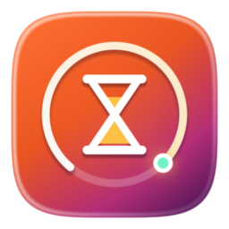

<div align="center">



# AuraTime

**Ubuntu / GNOME Dijital Denge ve Ekran Süresi Deneyimi — Windows İçin**

[](https://github.com)
[](https://www.python.org/)
[](LICENSE)

Ubuntu 24.10 / 25.04 (**GNOME 47/48 Ayarlar → Dijital Denge / Ekran Süresi**) işlevinin Windows işletim sistemi için geliştirilmiş, sıfır harici bağımlılıklı, hafif ve modern masaüstü uygulaması.

</div>

---

## ✨ Öne Çıkan Özellikler

- **⏱️ Gerçek Aktif Ekran Süresi Takibi (`GetLastInputInfo` & Kilit Algılama):**
  - Fare ve klavye etkinliğini gerçek zamanlı izler.
  - Belirlenen boşta kalma eşiği (varsayılan **3 dakika**, `1 / 3 / 5 / 10 / 15 dk` seçilebilir) aşıldığında, ekran kilitlendiğinde (`Win+L`) veya bilgisayar uykuya geçtiğinde sayımı otomatik duraklatır.
- **📊 Ubuntu / GNOME Tarzı Günlük ve Haftalık Grafikler:**
  - **Haftalık Sütun Grafiği (`Pzt – Paz`):** Günlük ekran süresi sınır çizgisi (kesikli yeşil çizgi), haftalık ortalama, önceki günle karşılaştırma ve herhangi bir güne tıklayarak o günün detaylarını inceleme.
  - **24 Saatlik Dağılım Grafiği (`00:00 – 23:00`):** Seçili günün her saatinde kaç dakika aktif kalındığını gösterir.
- **💻 Uygulama Bazlı Kullanım Dağılımı:**
  - Seçili günde hangi uygulama/pencerede (`Visual Studio Code`, `Firefox`, `Windows Gezgini` vb.) ne kadar süre ve yüzde kaç oranında vakit geçirildiğini listeler.
- **🌓 Günlük Ekran Süresi Sınırı & Gri Tonlama (Siyah-Beyaz Ekran):**
  - Günlük hedef süreye 15 dakika kala ve süre dolduğunda Windows sistem tepsisi bildirimi gönderir.
  - İsteğe bağlı olarak Ubuntu Wellbeing'deki gibi süre dolduğunda Windows Renk Filtresi ile ekranı otomatik **siyah-beyaz (gri tonlamalı)** yapar.
- **☕ Göz (20-20-20) ve Hareket Molası Hatırlatıcıları:**
  - Aralıksız kullanım sonrasında ekranın üst kısmında geri sayımlı mola penceresi ve bildirim açar.
- **📥 Sistem Tepsisi (System Tray), Başlangıçta Çalışma ve CSV Dışa Aktarma:**
  - Pencere kapatıldığında (`X` veya `Tepsiye Küçült`) saatin yanındaki **AuraTime** simgesinde (`<0.1%` CPU kullanımıyla) çalışmaya devam eder.
  - Tek tıkla **Windows Açılışında Arka Planda Başlat** ve tüm geçmişi **CSV Olarak Dışa Aktar** desteği.

---

## 🚀 Kurulum ve Çalıştırma

### Seçenek 1: Tek Dosya `.exe` İle Çalıştırma (Python Gerektirmez)
1. **`dist/AuraTime.exe`** (veya GitHub **Releases** sayfasındaki `AuraTime.exe`) dosyasını indirin ve çift tıklayın.
2. Veritabanı otomatik olarak `%LOCALAPPDATA%\AuraTime\screentime.db` konumunda tutulur; `.exe` dosyasını masaüstünde veya istediğiniz klasörde tek başına çalıştırabilirsiniz.

### Seçenek 2: Kaynak Koddan Çalıştırma
Hiçbir harici `pip` paketine ihtiyaç duymaz (yalnızca standart Python kütüphaneleri ve Windows Win32 `ctypes` API kullanır):

```powershell
# Konsolsuz masaüstü uygulaması olarak başlatmak için:
wscript.exe Baslat.vbs

# Veya terminalden:
python main.py

# Sistem tepsisinde küçültülmüş başlatmak için:
pythonw main.py --minimized
```

---

## 🛠️ Kaynak Koddan `.exe` Derleme (PyInstaller)

Kendi `.exe` dosyanızı oluşturmak için:

```powershell
python -m pip install -r requirements.txt
python build_exe.py
```

Derlenen tek dosya çalıştırılabilir uygulama **`dist/AuraTime.exe`** konumuna oluşturulur.

---

## 📁 Proje Yapısı

```text
ubuntu-screen-time/
├── assets/
│   ├── auratime.ico          # Çok çözünürlüklü (16..256px) Windows uygulama ve tepsi ikonu
│   ├── auratime_256.png      # Yüksek çözünürlüklü ana logo
│   ├── auratime_64.png       # Görev çubuğu ikonu
│   └── auratime_36.png       # Uygulama içi üst bar (HeaderBar) logosu
├── .github/workflows/
│   └── release.yml           # Otomatik Windows .exe derleme ve GitHub Release iş akışı
├── main.py                   # Ana giriş noktası ve tekil örnek (single-instance) kontrolü
├── ui.py                     # Ubuntu Yaru / GNOME Libadwaita tarzı masaüstü arayüzü
├── tracker.py                # Aktif/Boşta/Kilitli süre sayacı, sınır ve mola motoru
├── tray.py                   # Win32 Shell_NotifyIconW sistem tepsisi ve bildirim kontrolcüsü
├── win_api.py                # Win32 ctypes API, DWM koyu başlık çubuğu, başlangıç ve gri tonlama
├── database.py               # Thread-safe SQLite veri katmanı ve CSV dışa aktarıcı
├── logo.py                   # SDF vektörel logo ve çok katmanlı ICO/PNG üretici
├── build_exe.py              # PyInstaller tek dosya AuraTime.exe derleme betiği
├── Baslat.vbs / Baslat.bat   # Konsolsuz hızlı başlatıcılar
└── LICENSE                   # MIT Lisansı
```

---

## 📄 Lisans

Bu proje [MIT Lisansı](LICENSE) altında lisanslanmıştır.
